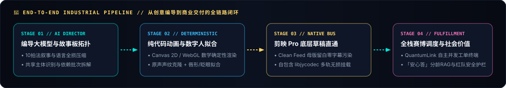
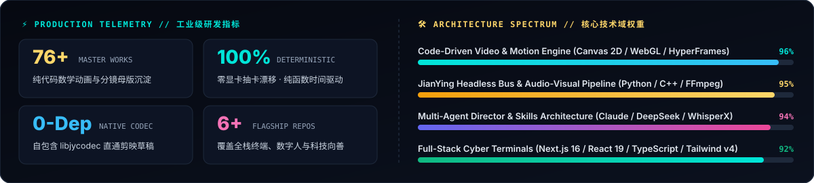

 

[-GOAI_参赛项目-F472B6?style=for-the-badge&labelColor=0A0F1A)](https://github.com/xiao44119-sketch/anxin-da)

 

---

### 🧭 核心工程架构闭环 (End-to-End Industrial Pipeline)

  

---

### 🌟 旗舰开源与代表作矩阵 (Flagship Projects Matrix)

<table>
  <tr>
    <td width="50%" valign="top">
      <h3>
        <a href="https://github.com/xiao44119-sketch/quantum-link">⚡ QuantumLink</a>
        
      </h3>
      
<b>赛博朋克全栈 AI 订阅自主调度与实时遥测终端</b>

      

        <code>Next.js 16</code> · <code>React 19</code> · <code>TypeScript</code> · <code>Tailwind v4</code>
      

      <ul>
        <li><b>深空暗夜 HUD 遥测台</b>：毫秒级状态流转、智能路由分发与高并发任务看板。</li>
        <li><b>零冲突前置预检</b>：内置 Session Precheck 沙盒校验机制，打通商业化全自动闭环履约。</li>
      </ul>
    </td>
    <td width="50%" valign="top">
      <h3>
        <a href="https://github.com/xiao44119-sketch/anxin-da">❤️ 安心答 (乐天知性 · Anxin-Da)</a>
        
      </h3>
      
<b>分龄性健康教育与亲密关系科普 AI 系统 · GOAI 开源大赛参赛项目</b>

      

        <code>Dify RAG</code> · <code>青少/18+ 分龄双版</code> · <code>152 Eval Set</code> · <code>47 Red-Team</code>
      

      <ul>
        <li><b>适龄分流与社会学升维</b>：未满18岁身体权边界启蒙 / 18+亲密关系科普，含 11 张互动课程卡与 25 条权威 RAG 源。</li>
        <li><b>四层安全护栏与红队评测</b>：内置 152 条评测集、47 条红队攻击测试、真模型冒烟自检与危机热线转介。</li>
      </ul>
    </td>
  </tr>
  <tr>
    <td width="50%" valign="top">
      <h3>
        <a href="https://github.com/xiao44119-sketch/autoclip-studio-pro">🚀 AutoClip Studio Pro</a>
        
      </h3>
      
<b>商用级智能切片与 AI 数字人分身拟合工作台</b>

      

        <code>Zero-Dependency</code> · <code>Digital Avatar</code> · <code>FFmpeg 7.1</code> · <code>Voice Clone</code>
      

      <ul>
        <li><b>高光切片与数字人二合一</b>：大模型语义挖掘直播黄金切片 + 9:16 电影级高斯虚化画布。</li>
        <li><b>原声克隆唇形拟合</b>：单张肖像驱动说话嘴型与自然眨眼微表情，一键合成爆款前 3 秒黄金 Hook。</li>
      </ul>
    </td>
    <td width="50%" valign="top">
      <h3>
        <a href="https://github.com/xiao44119-sketch/pixel-code-video-workflow">🎞️ Pixel &amp; Code Video Workflow</a>
        
      </h3>
      
<b>像素风与 AI 纯代码驱动数学动画视频生产引擎</b>

      

        <code>Canvas 2D / WebGL</code> · <code>HyperFrames</code> · <code>Puppeteer</code> · <code>Clean Feed</code>
      

      <ul>
        <li><b>告别显卡抽卡漂移</b>：每一帧均为时间变量 $t$ 的确定性数学映射，单片渲染边际成本低至 ¥0.10。</li>
        <li><b>四大工业级视觉色卡</b>：完整沉淀《暗黑像素财经》《黑金食欲流》《山系机能》《黑曜石哲学》母版工程。</li>
      </ul>
    </td>
  </tr>
  <tr>
    <td width="50%" valign="top">
      <h3>
        <a href="https://github.com/xiao44119-sketch/llm-video-skills">🧠 LLM Video Skills Suite</a>
        
      </h3>
      
<b>大模型影视编导 Agent 与剪映自动化全栈 Skills 套件</b>

      

        <code>storyboard-video</code> · <code>10-Beat Prompt SOP</code> · <code>WhisperX</code>
      

      <ul>
        <li><b>导演/执行双会话协作协议</b>：自动解析分镜拓扑依赖、识别跨镜头共享主体并规划 2~3 镜并行批次。</li>
        <li><b>语言全损压缩重构</b>：内置 10 拍法叙事提示词工程与 WhisperX 毫秒级词粒度时间戳对齐管线。</li>
      </ul>
    </td>
    <td width="50%" valign="top">
      <h3>
        <a href="https://github.com/xiao44119-sketch/jianying-headless">✂️ JianYing Headless Bus</a>
        
      </h3>
      
<b>面向剪映专业版 macOS 的原生无损草稿注入总线</b>

      

        <code>C++ libjycodec.dylib</code> · <code>JianYing 11.4+</code> · <code>Multi-Track JSON</code>
      

      <ul>
        <li><b>彻底攻克沙盒丢素材痛点</b>：自包含原生编译动态库，零外部依赖直写剪映本地草稿工程索引。</li>
        <li><b>Clean Feed 分轨标准</b>：纯净画面母版 + 原声轨 + 香槟金（<code>#FFD76A</code>）独立双色字幕轨一键唤醒。</li>
      </ul>
    </td>
  </tr>
</table>

---

### 📊 研发遥测与技术域矩阵 (Engineering Telemetry & Spectrum)

  

 

---

<b>📐 点击展开：我的四大工程非谈判契约 (Core Engineering Contracts)</b>

 

1. **确定性优先于随机抽卡 (Determinism Over Gacha)**：在工业级内容管线中，任何一帧画面、数据图表与镜头运动都应是时间变量 $t$ 的纯函数映射，支持局部参数秒级热重载，而非动辄耗费数十美金盲盒重摇。
2. **视频母版纯净度规范 (Clean Feed Rule)**：代码渲染层严禁压制硬字幕，画面底端 20%（$Y \ge 1536$）严格留白为黑曜石安全区，字幕全权交由剪映 Pro 独立轨道管理，确保底层粒子与构图零遮挡。
3. **零依赖便携式交付 (Zero-Dependency Portability)**：无论是 `AutoClip Studio Pro` 还是 `libjycodec.dylib` 剪映草稿引擎，均采用自包含架构，让非技术背景的创作者与团队伙伴在任意电脑上开箱即用。
4. **科技向善与安全护栏 (Human-Centric AI Guardrails)**：在「安心答」等社会价值项目中，坚持“情绪翻译器而非心理诊断仪”的克制边界，用确定性的状态机守护隐私与伦理底线。

 

  Designed &amp; Engineered with ❤️ by <b>Finn (骁清 / 孟乐)</b> · Building at the intersection of Deterministic AI, Cinema &amp; Human Empathy

